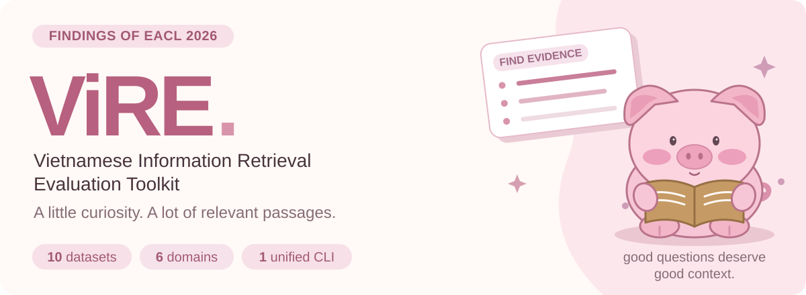
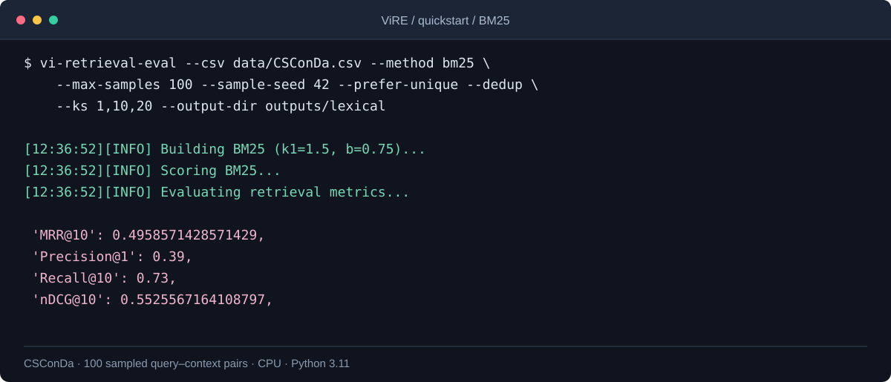
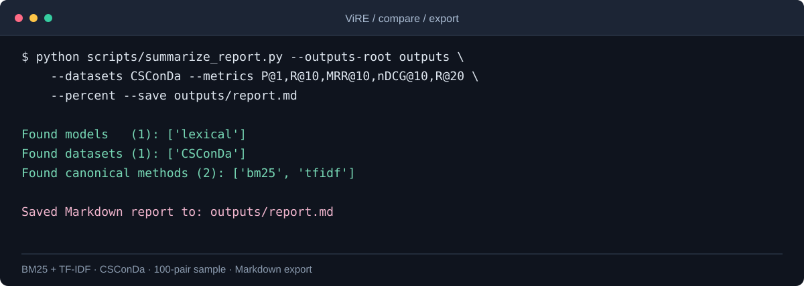
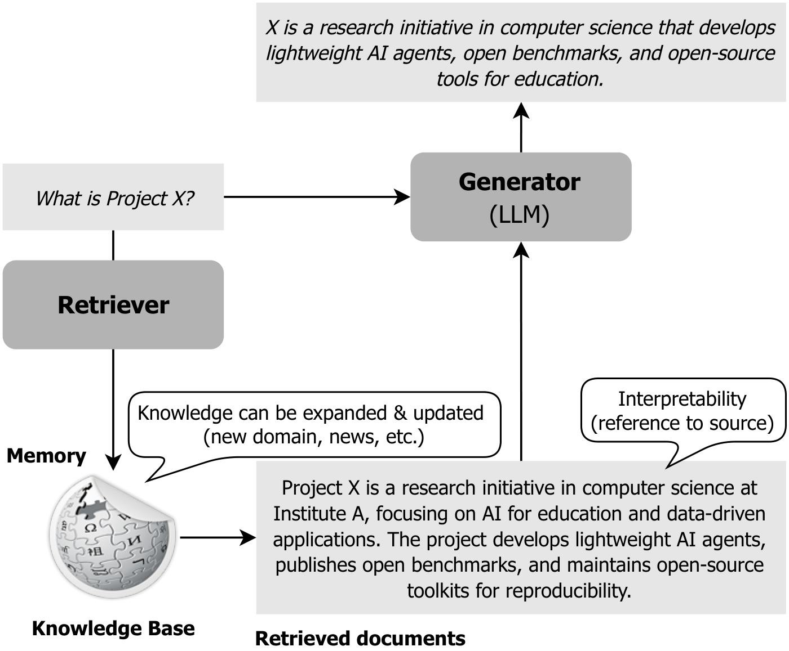
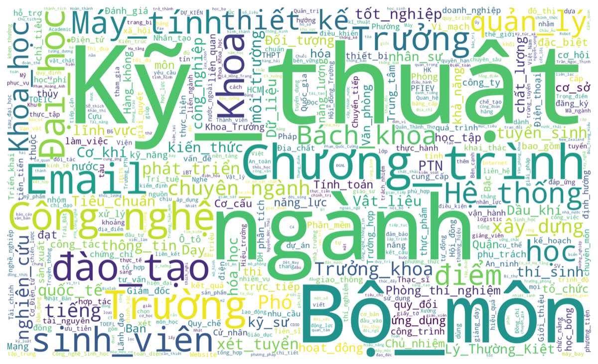
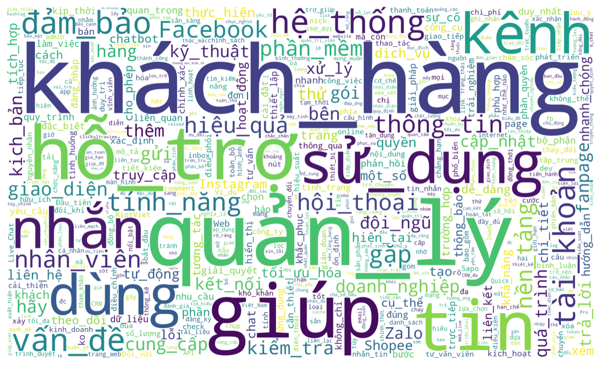
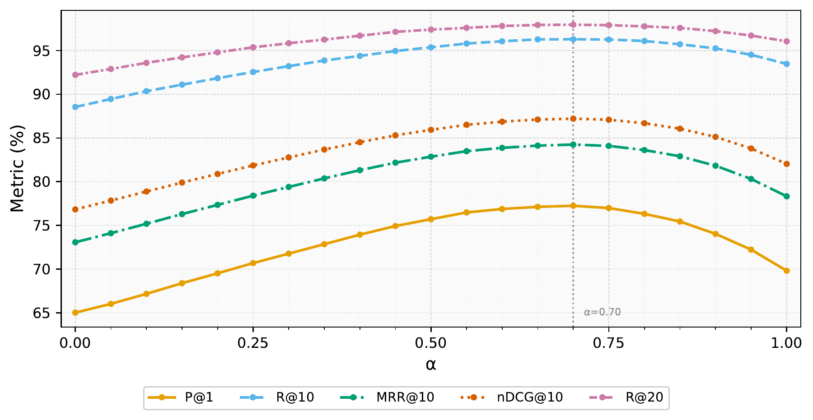

<p align="center">
  
</p>

<h2 align="center">Which Works Best for Vietnamese?<br>A Practical Study of Information Retrieval Methods across Domains</h2>

<p align="center">
  <a href="https://aclanthology.org/2026.findings-eacl.110/"></a>
  <a href="https://aclanthology.org/2026.findings-eacl.110/"></a>
  <a href="#quickstart"></a>
  <a href="LICENSE"></a>
</p>

<p align="center">
  <a href="#overview">Overview</a> · <a href="#quickstart">Quickstart</a> · <a href="#methods">Methods</a> · <a href="#datasets">Datasets</a> · <a href="#results">Results</a> · <a href="#findings">Findings</a> · <a href="#evaluate--extend">Evaluate &amp; Extend</a> · <a href="#citation">Citation</a>
</p>

<p align="center">
  <strong>Long S. T. Nguyen<sup>1,2,3</sup> · Tho T. Quan<sup>1,2</sup></strong><br><br>
  <sup>1</sup> URA Research Group, Ho Chi Minh City University of Technology (HCMUT), Vietnam<br>
  <sup>2</sup> Vietnam National University Ho Chi Minh City, Vietnam<br>
  <sup>3</sup> Center for AI Research (CAIR), VinUniversity, Vietnam
</p>

## Overview

**ViRE** is a toolkit for evaluating Vietnamese information retrieval across domains. It brings lexical, dense, learned-sparse, late-interaction, and hybrid retrieval into one CLI, with shared data preparation, ranking metrics, and per-query error analysis.

The accompanying study compares retrieval methods on **10 datasets across 6 domains** and introduces **EduCoQA** and **CSConDa**, drawn from educational counseling and customer-service interactions. The toolkit makes it straightforward to compare a new encoder, inspect retrieval failures, or evaluate your own question–document pairs.

Choose a starting point for your task:

| I want to… | Start here | Output |
| :-- | :-- | :-- |
| Run a first evaluation | [CPU quickstart](#quickstart) | Ranking metrics and missed-query examples |
| Compare retrieval methods | [Benchmark results](#results) · [Full report](VIRE_Report.md) | Scores grouped by dataset and backbone |
| Evaluate my own data | [Input format](#bring-your-own-data) · [Usage guide](docs/usage.md) | An evaluation on your question–passage pairs |
| Add a model or method | [Extension guide](#extend-the-toolkit) | A retriever connected to the shared evaluation pipeline |

## Quickstart

Use **Python 3.11+** for the dependency versions declared in this repository. The lexical example runs on CPU without API credentials or a model download.

```bash
git clone https://github.com/longstnguyen/ViRE.git
cd ViRE
python3.11 -m venv .venv
source .venv/bin/activate
python -m pip install -e .

vi-retrieval-eval --csv data/CSConDa.csv --method bm25 \
  --max-samples 100 --sample-seed 42 --prefer-unique --dedup \
  --ks 1,10,20 --output-dir outputs/lexical
```

<p align="center">
  
  <br><sub>BM25 retrieval and evaluation on a 100-pair CSConDa sample.</sub>
</p>

Read `metrics.json`, `ranks.json`, and `errors/fail@20.csv` in `outputs/lexical/CSConDa/bm25-s100-uniq-dedup/`. The failure file pairs missed queries with retrieved passages for error analysis. This example samples both the queries and their candidate contexts.

<details>
<summary><strong>Compare TF-IDF on the same sample and export a report</strong></summary>

```bash
vi-retrieval-eval --csv data/CSConDa.csv --method tfidf \
  --max-samples 100 --sample-seed 42 --prefer-unique --dedup \
  --ks 1,10,20 --output-dir outputs/lexical

python scripts/summarize_report.py --outputs-root outputs \
  --datasets CSConDa --metrics P@1,R@10,MRR@10,nDCG@10,R@20 \
  --percent --save outputs/report.md
```

<p align="center">
  
  <br><sub>Comparing BM25 and TF-IDF, then exporting a Markdown report.</sub>
</p>

</details>

### Try a dense–lexical hybrid

Install the optional backends, then combine a local Vietnamese encoder with BM25. Neural runs download the selected model and can use a GPU.

```bash
python -m pip install -e ".[all]"

vi-retrieval-eval --csv data/CSConDa.csv \
  --method dense+bm25 --dense-backend sbert \
  --sbert-model AITeamVN/Vietnamese_Embedding_v2 \
  --fusion alpha --alpha 0.7 --batch-size 16 \
  --max-samples 100 --sample-seed 42 --prefer-unique --dedup \
  --ks 1,10,20 --output-dir outputs/vietnamese-v2
```

See the [usage guide](docs/usage.md) for API backends, local LLM embedders, SPLADE, ColBERT, multi-gold relevance judgments, and the full CLI reference.

## Methods

ViRE follows a shared workflow: **load → normalize and sample → build the corpus → retrieve and fuse → evaluate → inspect errors**. Each retrieval family uses the same input data and evaluation interface.

| Retrieval family | `--method` | What it captures |
| :-- | :-- | :-- |
| Lexical | `tfidf`, `bm25` | Exact terms and vocabulary overlap |
| Dense | `dense` | Semantic similarity with local or API embedding models |
| Learned sparse | `splade` | Neural term expansion and sparse matching |
| Late interaction | `colbert` | Query–document token interactions |
| Hybrid | `dense+tfidf`, `dense+bm25`, `splade+tfidf`, `splade+bm25`, `splade+dense` | Complementary retrieval signals with score or rank fusion |

**Score fusion** uses `--fusion alpha --alpha 0.7`: dense similarity receives weight α after per-query min–max normalization in dense–lexical hybrids. For `dense+bm25`, this gives 0.7 to dense similarity and 0.3 to BM25. **Rank fusion** uses `--fusion rrf --rrf-k 60` to combine reciprocal ranks.

<details>
<summary><strong>Retrieval in a RAG system</strong></summary>

<p align="center">
  
  <br><sub>Retrieved passages provide evidence for answer generation; ViRE evaluates the retrieval stage.</sub>
</p>

</details>

## Datasets

The benchmark covers **six domains**. The study uses a sampling cap of **1,000 question–context pairs per dataset**, retaining all pairs for smaller datasets. Use `--max-samples` to select a subset from the available files.

| Domain | Datasets | Retrieval setting |
| :-- | :-- | :-- |
| Education | [EduCoQA](data/EduCoQA.csv), [ViRHE4QA](data/ViRHE4QA_v2.csv) [1] | Student counseling and institutional regulations |
| Customer support | [CSConDa](data/CSConDa.csv) | Conversational service requests |
| Legal | [ALQAC](data/ALQAC.csv), [ZaloLegalQA](data/ZaloLegalQA/) | Legal questions and statutory passages |
| Healthcare | [ViNewsQA](data/ViNewsQA.csv) [2], [ViMedAQA](data/ViMedAQA_v2.csv) [3] | Health news and medical questions |
| Lifestyle & reviews | [VlogQA](data/VlogQA_2.csv) [4], [ViRe4MRC](data/ViRe4MRC_v2.csv) [5] | Spoken narratives and customer reviews |
| Open knowledge | [UIT-ViQuAD 2.0](data/UIT-ViQuAD2.csv) [6] | Encyclopedic question answering |

### Two datasets from real conversations

EduCoQA captures student questions about admissions and university life; CSConDa contains customer-service conversations. Their frequent terms illustrate the vocabulary of these two domains.

<p align="center">
  
  <br><sub>EduCoQA: frequent topics in educational counseling.</sub>
</p>

<p align="center">
  
  <br><sub>CSConDa: frequent topics in customer-service conversations.</sub>
</p>

## Results

**MRR@10 across the ten datasets**, reported on a **0–100 scale**. “Best dense” and “Best hybrid” select the highest recorded MRR@10 in each family for each dataset; the winning backbone may differ by row. **Bold** marks the best value within a row, and <ins>underlining</ins> marks the second distinct value, including ties.

| Dataset | Domain | BM25 | Best dense | Best hybrid |
| :-- | :-- | --: | --: | --: |
| [EduCoQA](VIRE_Report.md#educoqa) | Education | 23.09 | <ins>34.22</ins> | **35.24** |
| [ViRHE4QA](VIRE_Report.md#virhe4qa_v2) | Education | <ins>76.05</ins> | 72.04 | **81.42** |
| [CSConDa](VIRE_Report.md#csconda) | Customer support | 22.99 | <ins>41.06</ins> | **43.60** |
| [ALQAC](VIRE_Report.md#alqac) | Legal | 92.20 | <ins>94.14</ins> | **96.66** |
| [ZaloLegalQA](VIRE_Report.md#zalolegalqa) | Legal | 79.39 | <ins>91.04</ins> | **91.67** |
| [ViNewsQA](VIRE_Report.md#vinewsqa) | Healthcare | <ins>66.13</ins> | 64.91 | **74.96** |
| [ViMedAQA](VIRE_Report.md#vimedaqa_v2) | Healthcare | 71.36 | <ins>87.94</ins> | **88.82** |
| [VlogQA](VIRE_Report.md#vlogqa_2) | Lifestyle & reviews | 23.90 | <ins>32.49</ins> | **39.53** |
| [ViRe4MRC](VIRE_Report.md#vire4mrc_v2) | Lifestyle & reviews | 10.25 | <ins>17.25</ins> | **18.21** |
| [UIT-ViQuAD 2.0](VIRE_Report.md#uit-viquad2) | Open knowledge | 78.09 | <ins>89.29</ins> | **93.62** |

The [complete results](VIRE_Report.md) provide every recorded configuration with **P@1, R@10, MRR@10, nDCG@10, and R@20**. See the [paper](https://aclanthology.org/2026.findings-eacl.110/) for the experimental protocol and domain-level analysis.

## Findings

The benchmark comparisons suggest five practical lessons for choosing encoders, tuning fusion, and evaluating Vietnamese retrieval.

- **Hybrid retrieval is the strongest overall starting point in this study.** Combining lexical and semantic evidence improves the best recorded MRR@10 over standalone dense retrieval across all **10 datasets**. BM25-based linear fusion is particularly effective across domains.
- **Calibrate the lexical–semantic balance.** The full-corpus UIT-ViQuAD experiment peaks around **α = 0.6–0.8**; the main benchmark uses **α = 0.7**. Exact terms and semantic similarity both contribute to ranking quality.
- **Language specialization and domain robustness are different strengths.** Vietnamese-specialized encoders perform strongly on formal institutional text, while multilingual encoders such as `multilingual-e5-large` and `bge-m3` offer strong performance across domains.
- **Parameter count does not determine retrieval quality.** The study finds substantial variation among LLM-derived embedders; larger models do not consistently outperform smaller encoders across these domains.
- **Conversational retrieval remains the harder test.** The best recorded MRR@10 is **96.66** on ALQAC, compared with **35.24** on EduCoQA and **43.60** on CSConDa. Abbreviations, register mismatches, and ambiguous intent make realistic user queries valuable evaluation targets.

<p align="center">
  
  <br><sub>Lexical–semantic balance on full-corpus UIT-ViQuAD with BM25 + multilingual-e5-large.</sub>
</p>

## Evaluate & Extend

Use the same evaluation workflow with your own data, then customize the retriever or metrics as needed. Start with the input schema below and use the configuration table to keep comparisons consistent.

### Bring your own data

Create a UTF-8 CSV with `question` and `context` columns. Each row pairs a query with its relevant passage; all retained contexts form the candidate corpus.

```csv
question,context
"Hồ sơ nhập học gồm những gì?","Hồ sơ nhập học gồm giấy báo trúng tuyển và giấy tờ cá nhân."
"Khi nào được đổi sản phẩm?","Khách hàng có thể yêu cầu đổi sản phẩm trong bảy ngày."
```

```bash
vi-retrieval-eval --csv your_dataset.csv --method bm25 \
  --normalize-all --dedup --output-dir outputs/your-baseline
```

For multiple relevant passages per query, use a separate `qid,doc_id,rel` file and explicit ID-column flags; see [multi-gold evaluation](docs/usage.md#multiple-relevant-documents).

### Configure an evaluation

Choose the data preparation, retrieval settings, and ranking cutoffs for your experiment. Keep the sample and preprocessing fixed when comparing methods.

| Setting | Flags | Purpose |
| :-- | :-- | :-- |
| Sampling | `--max-samples`, `--sample-frac`, `--sample-seed`, `--prefer-unique` | Control the sampled query–context pairs |
| Text preparation | `--normalize-all`, `--dedup` | Normalize Vietnamese text and merge identical contexts |
| Model and batching | `--dense-backend`, `--sbert-model`, `--batch-size`, `--max-len` | Select a backend and control embedding inputs |
| Retrieval | `--bm25-k1`, `--bm25-b`, `--fusion`, `--alpha`, `--rrf-k` | Configure lexical scoring and fusion |
| Analysis | `--ks`, `--error-k`, `--save-intersection` | Choose metric cutoffs and compare retrieval failures |
| Output and cache | `--output-dir`, `--force` | Separate experiments and rebuild cached embeddings/indexes |

Use distinct `--output-dir` values for separate experiment configurations. For report aggregation, follow `outputs/<model-or-group>/<dataset>/<method-tag>/`, as in the quickstart.

The [batch evaluation script](scripts/eval_full.sh) lists the study's datasets, backbones, and retrieval combinations. Review its model list and resource settings before launching the full suite; the [usage guide](docs/usage.md#batch-evaluation) explains the workflow.

### Extend the toolkit

The source separates embedding backends, retrieval, fusion, and evaluation. The table below identifies where to implement each extension and how to expose it through the CLI.

| Add or change | Start here | Connect it to the pipeline |
| :-- | :-- | :-- |
| Embedding backend | [`embeddings/base.py`](src/vi_retrieval_eval/embeddings/base.py) and [`embeddings/`](src/vi_retrieval_eval/embeddings/) | Implement `embed`, register the backend, import it in `embeddings/__init__.py`, and expose its CLI configuration |
| Retrieval algorithm | [`runner.py`](src/vi_retrieval_eval/runner.py), [`lexical.py`](src/vi_retrieval_eval/lexical.py), [`dense_index.py`](src/vi_retrieval_eval/dense_index.py) | Add the method branch and CLI choice |
| Fusion rule | [`fusion.py`](src/vi_retrieval_eval/fusion.py) | Connect the rule in `runner.py` and `--fusion` choices |
| Metric | [`metrics.py`](src/vi_retrieval_eval/metrics.py) | Add the per-query calculation and aggregate output; expose its name in reporting |
| Input format | [`io_utils.py`](src/vi_retrieval_eval/io_utils.py), [`qrels.py`](src/vi_retrieval_eval/qrels.py) | Map source data into questions, contexts, and relevance judgments |

## Citation

If you use ViRE or its datasets, please cite the [paper](https://aclanthology.org/2026.findings-eacl.110/).

```bibtex
@inproceedings{nguyen-quan-2026-works,
	title        = {{Which Works Best for Vietnamese?
	                 A Practical Study of Information Retrieval Methods across Domains}},
	author       = {Nguyen, Long S. T. and Quan, Tho T.},
	year         = 2026,
	month        = mar,
	booktitle    = {Findings of the Association for Computational Linguistics: EACL 2026},
	publisher    = {Association for Computational Linguistics},
	address      = {Rabat, Morocco},
	pages        = {2098--2119},
	doi          = {10.18653/v1/2026.findings-eacl.110},
	isbn         = {979-8-89176-386-9},
	url          = {https://aclanthology.org/2026.findings-eacl.110/},
}
```

## License

ViRE's source code is released under the [MIT License](LICENSE). The EduCoQA and CSConDa datasets are available under [Creative Commons Attribution–NonCommercial 4.0 International](https://creativecommons.org/licenses/by-nc/4.0/). Third-party datasets retain their original licenses and terms of use.

## References

[1] Tinh Pham Phuc Do, Ngoc Dinh Duy Cao, Khanh Quoc Tran, and Kiet Van Nguyen, “[R2GQA: retriever-reader-generator question answering system to support students understanding legal regulations in higher education](https://doi.org/10.1007/s10506-025-09457-7)”, _Artificial Intelligence and Law_, May 2025.

[2] Kiet Van Nguyen, Tin Van Huynh, Duc-Vu Nguyen, Anh Gia-Tuan Nguyen, and Ngan Luu-Thuy Nguyen, “[New Vietnamese Corpus for Machine Reading Comprehension of Health News Articles](https://doi.org/10.1145/3527631)”, _ACM Transactions on Asian and Low-Resource Language Information Processing_, volume 21, number 5, article 105, September 2022.

[3] Minh-Nam Tran, Phu-Vinh Nguyen, Long Nguyen, and Dien Dinh, “[ViMedAQA: A Vietnamese Medical Abstractive Question-Answering Dataset and Findings of Large Language Model](https://aclanthology.org/2024.acl-srw.31/)”, in _Proceedings of the 62nd Annual Meeting of the Association for Computational Linguistics (Volume 4: Student Research Workshop)_, Bangkok, Thailand, pages 252–260, August 2024.

[4] Thinh Ngo, Khoa Dang, Son Luu, Kiet Nguyen, and Ngan Nguyen, “[VlogQA: Task, Dataset, and Baseline Models for Vietnamese Spoken-Based Machine Reading Comprehension](https://aclanthology.org/2024.eacl-long.79/)”, in _Proceedings of the 18th Conference of the European Chapter of the Association for Computational Linguistics (Volume 1: Long Papers)_, St. Julian's, Malta, pages 1310–1324, March 2024.

[5] Tinh Pham Phuc Do, Ngoc Dinh Duy Cao, Nhan Thanh Nguyen, Tin Van Huynh, and Kiet Van Nguyen, “[Machine Reading Comprehension for Vietnamese Customer Reviews: Task, Corpus and Baseline Models](https://aclanthology.org/2023.paclic-1.3/)”, in _Proceedings of the 37th Pacific Asia Conference on Language, Information and Computation_, Hong Kong, China, pages 24–35, December 2023.

[6] Kiet Van Nguyen, Duc-Vu Nguyen, Anh Gia-Tuan Nguyen, and Ngan Luu-Thuy Nguyen, “[A Vietnamese Dataset for Evaluating Machine Reading Comprehension](https://aclanthology.org/2020.coling-main.233/)”, in _Proceedings of the 28th International Conference on Computational Linguistics_, Barcelona, Spain (Online), pages 2595–2605, December 2020.
